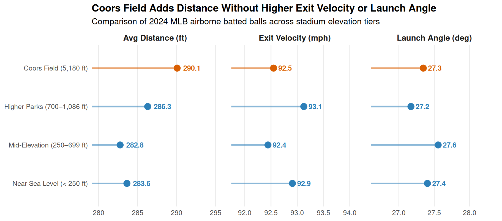

{width=912}

Across all 62,145 tracked fly balls and line drives in the 2024 MLB regular season, baseballs hit at Denver’s Coors Field (5,180 feet above sea level) traveled an average of **290.1 feet**—about 6.5 to 7.3 feet farther than balls hit in near-sea-level stadiums (283.6 feet) and mid-elevation ballparks (282.8 feet), with higher-elevation parks between 700 and 1,086 feet also sitting above sea level at 286.3 feet. As the second and third panels make clear, hitters at Coors Field did not generate this extra distance by swinging harder or lifting the ball higher: average exit velocity (92.5 mph) and average launch angle (27.3°) at Coors Field were virtually indistinguishable from lower-elevation stadiums across MLB.

Because aerodynamic drag increases with air speed, thin high-altitude air makes the biggest difference on hard-hit deep fly balls. Focusing specifically on solidly struck drives hit between 95 and 105 mph at launch angles between 20° and 35°, exit velocity (99.8 vs. 99.9 mph) and launch angle (26.9° vs. 26.9°) are identical, yet balls at Coors Field traveled an average of **384.1 feet** compared to **367.2 feet** across the other 29 MLB parks. That **16.9-foot boost** in carry often turns routine warning-track flyouts into home runs or extra-base hits, explaining why Colorado built deeper outfield walls and still leads baseball in high-altitude offensive environment.

Several important limitations should be kept in mind when interpreting stadium-level averages. Elevation is not the only atmospheric factor affecting ball flight: game-time temperature, humidity, wind speed and direction, retractable roofs, and MLB’s standardized baseball humidors all influence air density and carry. In addition, Coors Field sits more than 4,000 feet higher than the second-highest MLB stadium (Chase Field at 1,086 feet), meaning MLB has a large elevation gap rather than stadiums evenly spaced across altitudes, and seasonal park averages still reflect small differences in team rosters and pitching matchups.
